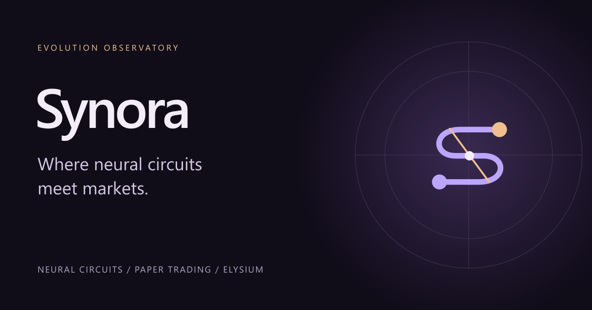
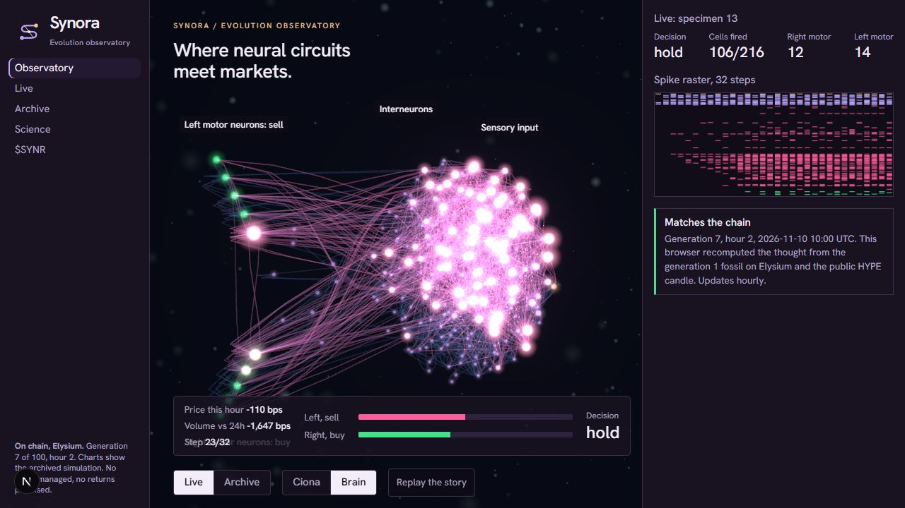
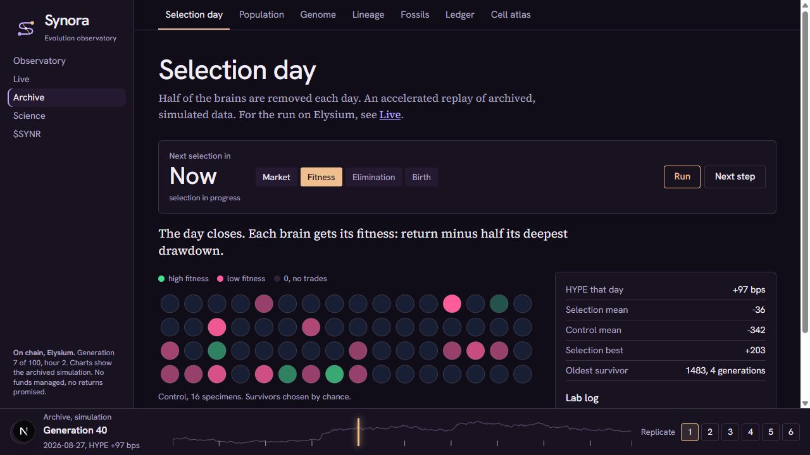
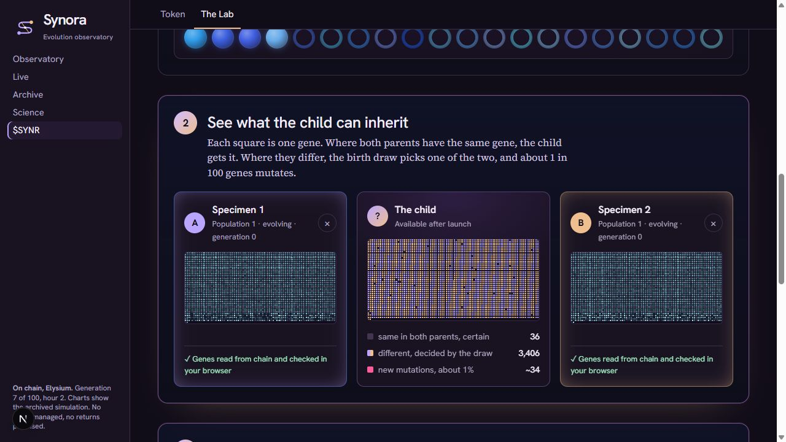
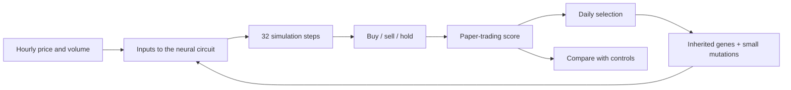
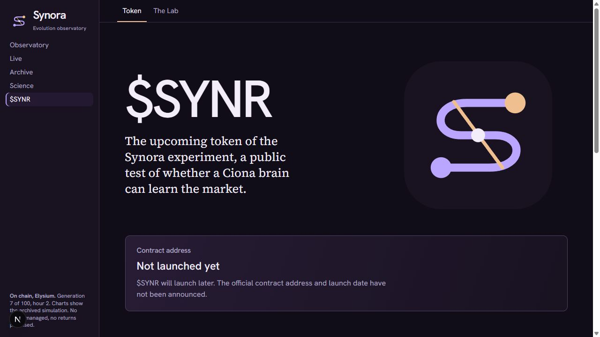

**A visual laboratory for a simple question: can selection help a tiny neural circuit respond to a market?**

Research observatory · Paper trading · Elysium · **$SYNR: not launched**

[Start here](#what-is-synora) · [See the interface](#a-guided-tour) · [How it works](#how-it-works) · [The evidence](#what-counts-as-evidence) · [Token](#synr-and-the-lab) · [FAQ](#questions-you-might-have)

> This repository is a product showcase. It contains the explanation and screenshots, not the application source, a runnable build, wallet information or deployment configuration. The images show the implemented interface; they are not a public app or a token launch announcement.

## What is Synora?

Synora makes a computational experiment visible. You can watch a small artificial brain receive market data, trace its signals, inspect its simulated decisions, and see how a population changes through selection.

Think of it as **an observatory with a replay button**. Instead of looking at a single trading result, you can inspect the process that produced it: the wiring, the inherited parameters, the inputs, the decisions and the comparison with a control group.

The research uses the mapped nervous system of a *Ciona* sea-squirt larva as a starting point. These are mathematical models, not living animals and not language-model agents. The mapping of market inputs onto biological cells is an experimental design choice.

| In plain language | In the experiment |
| --- | --- |
| **Brain** | A small simulated circuit that receives inputs and produces buy, sell or hold decisions. |
| **Genome** | The parameters that determine connection strength, firing thresholds and excitation or inhibition. |
| **Generation** | One day of evaluation, followed by selection and breeding. |
| **Fossil** | A saved genome that can be inspected and compared later. |
| **Paper trade** | A simulated decision and score. It does not place a real market order. |

## A guided tour

The sections below show real screens. Click an image to inspect it at full size.

### 1. Watch a brain think

**Observatory** connects the circuit to the decision. Follow the sensory inputs, the interneurons and the two motor sides. The panel shows firing activity and the resulting buy, sell or hold output.

The interface distinguishes archived simulations from existing public research records. A displayed match means that a computation agrees with the record; it is not evidence of profitable trading.

<b>What should I look at first?</b>

1. Start with the incoming price and volume signals.
2. Follow how activity propagates through the circuit.
3. Compare the left and right motor outputs.
4. Read the final decision alongside the verification status.

The positions of cells in the circuit view make signal flow readable. They are not a reconstruction of their physical positions in the animal.

### 2. Follow a generation

**Archive** turns population changes into a replay. Selection day shows the four stages; the surrounding views let you inspect populations, genomes, ancestry, saved fossils, recorded events and the cell atlas.

| View | What it helps you understand |
| --- | --- |
| Selection day | Which specimens survive, which disappear and how offspring are formed. |
| Population & Genome | How individuals differ and what their parameters encode. |
| Lineage & Fossils | Where an individual came from and which genomes were preserved. |
| Ledger & Cell atlas | The sequence of records and the components of the circuit. |
| Science & Verify | The method, limitations, comparison groups and verification process. |

### 3. Explore a possible child

**The Lab** is a separate planned experience. Pick research fossils and compare what a child could inherit. The preview explains the process before any wallet operation becomes available.

The Synora token and its Lab have not launched. Approval and breeding transactions are disabled. The Lab does not change the scientific experiment or its result.

## How it works

1. **Sense.** Each brain receives hourly price movement and trading-volume inputs.
2. **Propagate.** Signals run through the same wiring for 32 steps. Each genome changes how that circuit behaves.
3. **Decide.** The two motor sides are compared. A sufficiently stronger right side means buy; a stronger left side means sell; otherwise the brain holds.
4. **Score.** Paper performance is evaluated with transaction costs and a drawdown penalty.
5. **Select.** Better-performing specimens survive and produce offspring with small mutations. A separate control population uses randomly chosen survivors.
6. **Compare.** The scientific question is whether selection improves performance on data that were not used for selection.

<b>Show the research parameters</b>

These describe the existing research protocol represented by the interface. They are not a claim that a new independent Synora experiment has been deployed.

| Parameter | Research protocol |
| --- | --- |
| Reconstructed circuit | 216 cells and 3,010 connections |
| Population per replicate | 64 selection specimens and 16 controls |
| Generation length | 24 hourly inputs |
| Selection period | 100 generations |
| Planned holdout in the locked protocol | 28 unseen days |
| Main comparison | Six independent replicates |
| Mutation rate | 1% per gene |
| Fitness | Return minus half the deepest drawdown |
| Position-change fee | 3 basis points |

The archive includes earlier historical tests. Those screenshots must not be read as the final outcome of the locked protocol. The reconstructed matrix contains 216 cells with different roles in the circuit.

## What counts as evidence?

**A convincing animation is not a scientific result.** The interface exposes comparisons and limitations so a viewer can separate a recorded computation from evidence of learning.

| Question | How it is addressed |
| --- | --- |
| Is selection doing more than chance? | Compare with a control population whose survivors are chosen randomly. |
| Is it merely benefiting from market direction? | Compare with not trading, and evaluate an unseen period. |
| Are many related brains being counted as independent evidence? | Test across independent replicates, not across siblings in one population. |
| Does the circuit’s structure matter? | Report shuffled-wiring runs as a separate exploratory comparison. |
| Can someone check a recorded result? | Recompute decisions, scores and genomes from public inputs and compare the records. |

The research protocol requires the selection population to beat both control and not trading under its pre-specified test. Synora does **not** claim that market learning has been established. Even a successful result on one period would not establish future returns.

The wiring is based on the peer-reviewed [Ciona connectome study by Ryan, Lu and Meinertzhagen](https://doi.org/10.7554/eLife.16962). Biology supplies the circuit map; applying market data to that map is the computational experiment.

## $SYNR and the Lab

| Item | Current status |
| --- | --- |
| Token name | Synora |
| Ticker | **$SYNR** |
| Token release | **Not launched** |
| Official contract address | **Not published** |
| Launch date | **Not announced** |
| Synora Lab transactions | **Disabled until the token and its matching Lab are deployed** |
| Token page | `/token/` within the application |

The planned Lab uses tokens to breed a child that paper-trades for one day. Its planned cost and daily cap are shown as plans, not as already deployed terms. It offers no prizes, ownership of experimental results or claim on revenue.

## Questions you might have

<b>Does Synora trade my money?</b>

No. The experiment scores paper trades. Its scientific records and simulated decisions are separate from the Lab's planned token transactions, which are currently disabled.

<b>Does each brain learn while it is trading?</b>

Its parameters are fixed during evaluation. Change occurs across generations through selection, crossover and mutation. That is different from an individual updating its weights after every trade.

<b>Why use a blockchain?</b>

The existing research uses Elysium to preserve ordered records and commitments. This helps independent checking. Recording something on chain does not, by itself, prove that its interpretation or trading strategy is correct.

<b>Can I run the app from this repository?</b>

No. This is a documentation and image showcase. It contains no application source, install scripts, compiled application or deployment bundle. A public Synora application URL is not announced here.

<b>What does this showcase demonstrate?</b>

It demonstrates the Synora interface and explains the experimental model it presents. A product presentation does not establish a new scientific discovery, independent experimental results or exclusive ownership of the underlying methods.

## About this presentation

This repository contains presentation material only. It does not provide an application download, a source-code distribution or an installation package.

Screenshots are illustrative snapshots, not live telemetry or performance promises. See [THIRD_PARTY_NOTICES.md](THIRD_PARTY_NOTICES.md) for the scope of the presentation and biological research credits.

[Back to the top](#)
